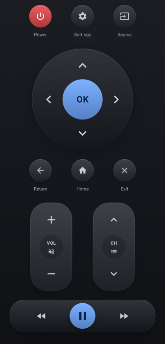
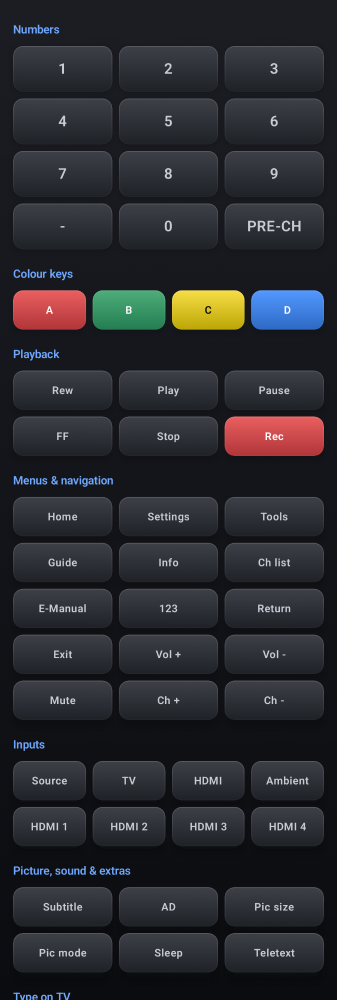
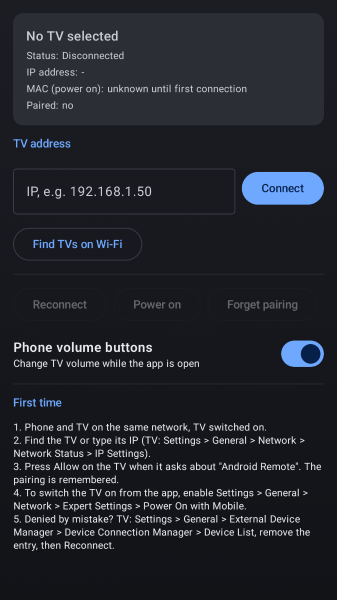

# Samsung Remote

A simple, free Android remote for **my** Samsung TV. It works over the local network, with no ads,
no account, no cloud and no tracking.

I wanted a plain remote on my phone for one TV, without the SmartThings app or the ad-filled
"universal remote" apps. That's all this project does. It is shared in case it helps someone with
the same TV.

<p>
  
  
  
</p>

## Compatibility

> [!WARNING]
> Tested on **one** TV only (listed below). Every other model, firmware or setup is **untested**.
> It may work, partly work or not work at all. No guarantees, use at your own risk.

What it was built and tested against:

| | |
|---|---|
| TV model | Samsung **UE55AU9005KXXC** (55" AU9000 series, 2021, European model) |
| TV OS | **Tizen 6.0** (2021 platform, model code `21_NIKEL_UHD`, remote API `2.0.25`) |
| TV connection | Ethernet cable, phone on Wi-Fi in the same home network (same subnet) |
| Phone | Android **8.0 or newer** (minSdk 26, targets Android 15 / API 35) |

Other Samsung TVs from 2016 onwards run Tizen and expose the same local remote-control API
(`wss://<tv>:8002`), so many of them will *probably* work. I haven't tried any of them.
Some keys (for example Ambient mode, Picture mode, Teletext) may do nothing on other models.

Not supported: IR blasters, pre-2016 Samsung TVs (Orsay, port 55000), other brands.

## Features

- **Remote tab**: Power, Settings, Source, arrows + OK, Return, Home, Exit, Volume (with Mute),
  Channel (with Channel list), Rewind, Play/Pause toggle, Fast-forward.
- **More keys tab**: numbers 0-9, `-`, Pre-Ch, colour keys A-D, Play, Pause, Stop, Rec, Guide, Info, Tools,
  123, E-Manual, TV, Ambient, HDMI and HDMI 1-4, Subtitle, Audio description, Picture size, Picture
  mode, Sleep, Teletext, Volume and Channel. You can also type text into the TV's on-screen keyboard
  and send any raw `KEY_*` code.
- Arrows, volume and channel repeat while held. Long press on Power, Home, Return and OK holds the
  key on the TV (long Power opens the TV's power menu).
- **Power on** through Wake-on-LAN. The TV's MAC address is learned on the first connection.
- Phone volume buttons control the TV volume while the app is open (can be switched off).
- Finds the TV automatically (SSDP + a scan of the local subnet), or you type its IP.
- Pairs once: the TV asks you to *Allow* the first time, then the app remembers it.

The TV doesn't report whether something is playing, so the Play/Pause button shows the opposite of
the last key it sent. If it gets out of step (for example after you use the physical remote), one
extra tap fixes it.

## Install

There is no Play Store release. Build the APK yourself (below) and install it:

- **USB**: enable *Developer options > USB debugging* on the phone, then
  `adb install -r app/build/outputs/apk/release/app-release.apk`
- **Without a cable**: copy the APK to the phone, open it and allow "Install unknown apps" for the
  app you opened it with.

## Build

Requirements:

- JDK 17 or newer
- Android SDK with **platform 35** and **build-tools 35** (Android Studio installs them, or
  `sdkmanager "platforms;android-35" "build-tools;35.0.0"`)
- The SDK location in `ANDROID_HOME`, or a `local.properties` file in the project root:

  ```properties
  sdk.dir=/path/to/Android/Sdk
  ```

You don't need Gradle installed: the wrapper downloads Gradle 8.11.1 on the first run.

```bash
git clone https://github.com/sergiocastrovale/samsung-remote.git
cd samsung-remote
./gradlew assembleRelease   # app/build/outputs/apk/release/app-release.apk (about 1.2 MB)
./gradlew assembleDebug     # app/build/outputs/apk/debug/app-debug.apk
./gradlew test              # unit tests
```

Without a signing setup, the release APK is signed with your local debug key. That's fine for your
own phone. To sign with your own key:

```bash
keytool -genkeypair -v -keystore remote.jks -keyalg RSA -keysize 2048 -validity 10000 -alias remote
```

Then create `signing.properties` in the project root (both files are git-ignored):

```properties
storeFile=remote.jks
storePassword=...
keyAlias=remote
keyPassword=...
```

## First use

1. Phone and TV on the same network, TV switched on.
2. Open the app. It starts on **Setup**: tap **Find TVs on Wi-Fi** and pick the TV, or type its IP
   (TV: *Settings > General > Network > Network Status > IP Settings*).
3. The TV asks about **"Android Remote"**: press **Allow**.
4. To switch the TV **on** from the app, enable on the TV:
   *Settings > General > Network > Expert Settings > Power On with Mobile*.

Tip: reserve the TV's IP in your router (DHCP reservation) so it never changes.

## Troubleshooting

| Problem | Fix |
|---|---|
| "Denied on the TV" | TV: *Settings > General > External Device Manager > Device Connection Manager > Device List*. Delete "Android Remote", then tap **Reconnect** in the app and press Allow. |
| TV not found | Setup shows the phone's own IP. The TV's IP must be in the same subnet (e.g. both `192.168.1.x`). Guest Wi-Fi networks and "client isolation" on the router block this. Type the IP by hand if discovery fails. |
| Power on does nothing | Enable *Power On with Mobile* and connect once while the TV is on so the app learns its MAC. |
| Keys stop working after a while | The TV drops idle connections. The next key press reconnects, or use **Setup > Reconnect**. |
| Want to pair again | **Setup > Forget pairing**, then **Reconnect**. |

## How it works

The app talks directly to the TV on your local network:

- Keys: WebSocket `wss://<tv>:8002/api/v2/channels/samsung.remote.control` with
  `ms.remote.control` messages. The TV's certificate is self-signed, so that one connection
  accepts it.
- Pairing: the TV returns a token after you press Allow. It is stored on the phone and sent on
  later connections.
- TV details (name, model, MAC, power state): `http://<tv>:8001/api/v2/`.
- Power on: a Wake-on-LAN magic packet. Power off: `KEY_POWER`.

Nothing leaves your home network. The app has no analytics and needs no Samsung account.

```
app/src/main/java/com/kp/samsungremote/
  MainActivity.kt            tabs, phone volume keys
  tv/Payloads.kt             WebSocket URL and JSON messages, pairing events
  tv/SamsungTvClient.kt      WebSocket connection, pairing token, queued keys
  tv/Keys.kt                 KEY_* codes
  tv/TvInfo.kt               TV details from port 8001
  tv/WakeOnLan.kt            power on
  tv/SsdpDiscovery.kt        discovery (SSDP)
  tv/NetworkScan.kt          discovery (subnet scan)
  data/Prefs.kt              saved IP, token, MAC
  ui/                        Compose screens and view model
```

Built with Kotlin, Jetpack Compose and OkHttp.

## Disclaimer

Not affiliated with or endorsed by Samsung. "Samsung" and "Tizen" are trademarks of their
respective owners.
